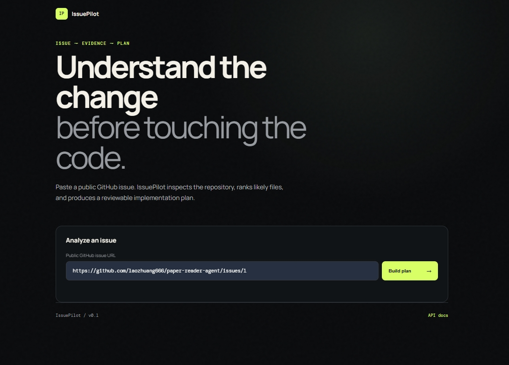
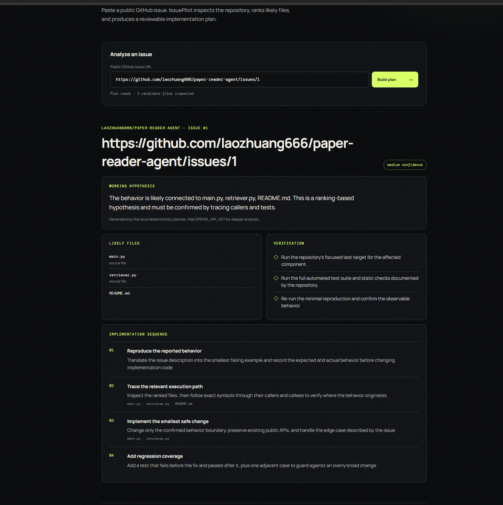

# IssuePilot

**From a public GitHub issue to an evidence-backed implementation plan.**

IssuePilot reads a GitHub issue, inspects the repository tree, ranks potentially relevant files,
and produces a reviewable plan before any code is changed. It is designed as a transparent,
portfolio-ready foundation for an Issue-to-PR agent. Version 0.3 supports OpenAI, DeepSeek,
OpenRouter, and local Ollama models through a bounded tool-use loop, so the model can search paths,
read files, and trace symbols before planning.

## Demo

### Analyze a public GitHub issue



### Review repository evidence and an implementation plan



> Current scope: analysis and planning. Version 0.3 deliberately does **not** modify repositories,
> run untrusted code, or open pull requests. Those actions belong in a later sandboxed execution
> stage.

## Why this project is different

Many coding-agent demos jump directly from a prompt to a patch. IssuePilot keeps the evidence
visible:

- validates and fetches a public GitHub issue through the REST API;
- filters generated, vendored, binary, and oversized files;
- ranks likely files using explicit filenames and issue/path term overlap;
- fetches bounded source previews instead of cloning arbitrary code;
- creates a deterministic local plan when no model key is configured;
- supports OpenAI, DeepSeek, OpenRouter, and local Ollama models through provider adapters;
- lets the model call three read-only repository tools in a bounded multi-turn loop;
- records every tool call and exposes the execution trace in the API and web interface;
- exposes both a web interface and a documented FastAPI endpoint.

## Architecture

```text
Issue URL
   |
   v
URL validation --> GitHub API --> filtered repository tree
                                      |
                                      v
                              relevance ranking
                                      |
                         bounded source-file evidence
                                      |
                         +------------+--------------------+
                         |                                 |
                  local planner                 tool-using agent
                                                           |
                                             search / read / trace
                         |                                 |
                         +------------+--------------------+
                                      |
                            reviewable action plan
```

The service never executes repository code. GitHub and model credentials stay server-side.

## Quick start

Requirements: Python 3.11 or newer.

### One-click start on Windows

Double-click `一键启动IssuePilot.bat`. On the first launch it creates the local environment,
installs dependencies, creates a private `.env` file, starts the API, and opens the browser.
Keep the launcher window open while using IssuePilot and press `Ctrl+C` to stop it.

### Manual setup

```bash
git clone https://github.com/YOUR_NAME/issuepilot.git
cd issuepilot
python -m venv .venv
```

Activate the environment:

```powershell
# Windows PowerShell
.venv\Scripts\Activate.ps1
```

```bash
# macOS / Linux
source .venv/bin/activate
```

Then install and run:

```bash
pip install -e ".[dev]"
cp .env.example .env  # On Windows: Copy-Item .env.example .env
uvicorn issuepilot.api:app --reload
```

Open <http://localhost:8000>. Interactive API documentation is available at
<http://localhost:8000/docs>.

`GITHUB_TOKEN` is optional but recommended because anonymous GitHub API access has a low rate
limit. Copy `.env.example` to `.env`, then configure one model provider:

```env
LLM_PROVIDER=deepseek
LLM_API_KEY=your_deepseek_api_key
LLM_BASE_URL=https://api.deepseek.com
LLM_MODEL=deepseek-flash
```

Supported provider values and defaults:

| Provider | Default endpoint | Default model | API key required |
| --- | --- | --- | --- |
| `openai` | OpenAI API | `gpt-5-mini` | Yes |
| `deepseek` | `https://api.deepseek.com` | `deepseek-flash` | Yes |
| `openrouter` | `https://openrouter.ai/api/v1` | `openai/gpt-5-mini` | Yes |
| `ollama` | `http://127.0.0.1:11434/v1` | `qwen3:8b` | No |

For Ollama, install the selected model locally before starting IssuePilot:

```bash
ollama pull qwen3:8b
```

Without a configured remote key, or when a provider is unavailable, IssuePilot uses the
deterministic local planner. Existing `OPENAI_API_KEY` and `OPENAI_MODEL` settings remain supported
for backward compatibility.

When a model provider is configured, the agent can call only these read-only tools:

- `search_paths`: find files in the filtered repository tree;
- `read_file`: read a bounded line range from an allowed file;
- `search_code`: search literal symbols or phrases in repository text files.

Tool rounds, result sizes, file sizes, and repository file counts are bounded by environment
settings. If the agent fails or exceeds its round limit, IssuePilot falls back to the local planner.

## Docker

```bash
docker compose up --build
```

Then open <http://localhost:8000>.

## API example

```bash
curl -X POST http://localhost:8000/api/analyze \
  -H "Content-Type: application/json" \
  -d '{"issue_url":"https://github.com/owner/repository/issues/123"}'
```

## Tests and quality checks

```bash
pytest
ruff check .
```

The GitHub Actions workflow runs both commands for pushes to `main` and pull requests.

## Roadmap

- [x] Public GitHub issue ingestion
- [x] Repository-tree filtering and relevance ranking
- [x] Evidence-backed local and model planners
- [x] Responsive web interface and REST API
- [x] Bounded multi-turn agent with repository search and read tools
- [x] User-visible agent execution trace
- [x] OpenAI, DeepSeek, OpenRouter, and Ollama provider adapters
- [ ] Symbol-aware code navigation using tree-sitter
- [ ] Ephemeral Docker sandbox for repository checkout and test execution
- [ ] Patch generation with human approval gates
- [ ] Evaluation set with plan-quality and file-recall metrics
- [ ] GitHub App integration for draft pull requests

## Safety boundaries

- Only public GitHub issue URLs are accepted in version 0.3.
- Repository files are fetched as data; no repository code is executed.
- Large, binary, generated, dependency, and vendor paths are excluded.
- Source previews and repository file counts are bounded by configuration.
- Plans are suggestions and explicitly require human review.


## License

[MIT](LICENSE)
